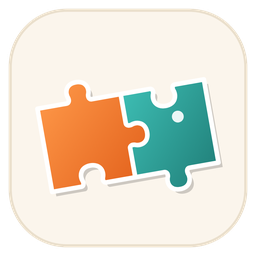

# Snugfit

**Relaxing jigsaw puzzles for Windows.** Cozy pictures, satisfying snaps, and five new puzzles every month.



## Features

- **10 puzzles to start**: the October Collection (5 Halloween and autumn puzzles) plus the Starter Collection (Boston Terriers, flowers, ocean life, forest, and a church stained-glass window).
- **4 difficulty levels** per puzzle: Beginner (about 100 pieces), Easy (about 250), Medium (about 500) and Advanced (1,000).
- Freshly cut pieces with natural tab shapes every game. Pieces snap together and lock onto the board.
- Preview picture, ghost image, edge-pieces-only filter, Tidy, zoom and pan.
- **Autosave**: continue your last puzzle from the main menu, or pick any saved puzzle.
- **Options**: music and sound-effect volume, light and dark themes, table colors, fullscreen.
- **Built-in updater**: checks this repo's GitHub Releases and installs new versions.
- Original background music and sound effects.

## Installing

Download `Snugfit-Setup-<version>.exe` from [Releases](https://github.com/adamglassner/snugfit/releases) and run it. It installs for your Windows account, so no administrator rights are needed. Saved puzzles and settings live in `%APPDATA%\Snugfit`.

## Controls

| Action | How |
|---|---|
| Move a piece or group | Left-drag |
| Pan the table | Drag empty table, right-drag, or hold Space and drag. Arrow keys also pan |
| Zoom | Mouse wheel, `+` / `-`, or the buttons in the corner |
| Fit everything | `F` |
| Preview, ghost, edges only, tidy | `P`, `G`, `E`, `T` |
| Save now | `Ctrl+S` (it also saves automatically) |
| Pause menu | `Esc` |
| Fullscreen | `F11` |

## Releasing an update (monthly puzzles)

1. Add the new pictures (5 per month):
   ```
   pip install pillow
   python tools/add_puzzle.py my-picture.jpg "Snowy Cabin" --collection 2026-11 --collection-title "November Collection" --subtitle "Cozy late-autumn scenes"
   ```
   Repeat for each picture. The newest collection shows first in the app.
2. Bump `Version` in `version.go` (for example `1.1.0`) and add a `## Version 1.1.0` section at the top of `CHANGELOG.md`.
3. Commit, then tag and push:
   ```
   git tag v1.1.0
   git push origin main --tags
   ```
4. The **Release** GitHub Action builds `Snugfit.exe` and the installer, then publishes a GitHub Release with `Snugfit-Setup-1.1.0.exe`. Players get it via **Options > Check for updates** (or automatically on startup).

The updater compares the release tag (`v1.1.0`) with the app's version and downloads the asset whose name contains `Setup` and ends in `.exe`.

## Building yourself

Requirements: [Go 1.24+](https://go.dev/dl/) and [NSIS 3](https://nsis.sourceforge.io/) (`makensis` on your PATH).

```
./build.sh            # Git Bash on Windows, or Linux/macOS
```

Output: `dist/Snugfit/` (the app plus its `assets` folder) and `dist/Snugfit-Setup-<version>.exe`.

To run from source on Windows: `go run .` (the app finds the `assets` folder next to the exe or in the current folder).

`go.mod` points the `golang.org/x/...` modules at their official GitHub mirrors, so builds work even where golang.org is blocked.

## Project layout

```
main.go, menu.go, gallery.go, scenes.go   app shell and screens
play.go, puzzle_gen.go                    puzzle engine (cutting, snapping, saving)
ui.go, draw.go, theme.go                  UI toolkit and light/dark themes
updater.go                                GitHub Releases updater
assets/                                   puzzles, music, sound effects, fonts, logos
installer/snugfit.nsi                     themed NSIS installer
branding/                                 logo, icon, installer artwork
tools/                                    puzzle, art and audio helper scripts
```

## License

Copyright (c) 2026 Adam Glassner. All rights reserved. See `LICENSE.txt` and `THIRD-PARTY-NOTICES.txt`.
